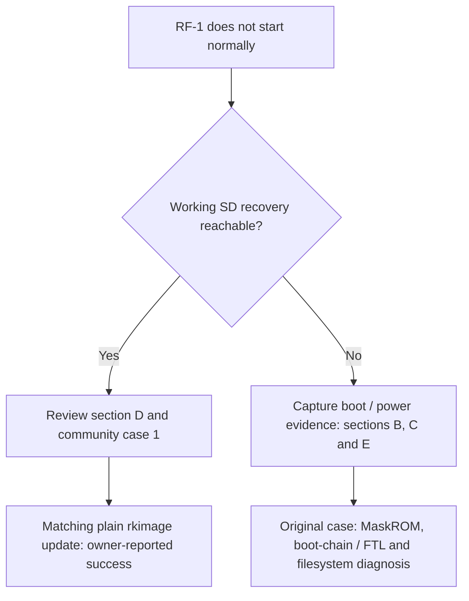

# Conservative RF-1 diagnostic decision tree

This is not a blind recipe. Use the least invasive layer that can still answer the current question.

## First distinguish recovery availability

The [second-unit recovery update](COMMUNITY_RECOVERY_CASE_01.md) depends on a
working recovery menu. Recovery was no longer being reached in the original
successful repair, which required the [deeper case-specific path](SUCCESSFUL_RECOVERY_PATH.md).
An unavailable recovery menu does not by itself establish the same NAND damage
or justify replaying the historical writers.

## A. Unit reaches the Retro Freak splash or menu

If normal startup hangs at the splash but SD recovery works, review section D
and the second-unit report before considering a diagnostic boot or low-level work.

1. Obtain logs before modifying NAND.
2. If possible, enable/obtain ADB without replacing more of the boot chain than necessary.
3. Check mount state and kernel errors:
   - `/system`
   - `/data`
   - `/cache`
4. If `/system` files fail to load, read the **entire Linux-visible system partition** and compare with the matching official image.
5. If `/data` is read-only, back it up while unmounted and test `e2fsck` on a copy before any live repair.

## B. Unit powers normally but remains on a white screen

1. Do not assume the NAND is dead.
2. Review the documented community recovery option before low-level NAND work. It is not a manufacturer-supported RF-1 rescue procedure; factory reset may destroy data. Preserve accessible data and obtain explicit approval before any reset.
3. If recovery cannot be selected, capture early boot evidence rather than repeatedly rewriting SD cards.
4. If a diagnostic boot can provide root ADB, prefer live Linux-visible partition auditing over physical guesses.

## C. Unit does not hold power after releasing Power

1. Confirm that the service/MaskROM path still works.
2. Do not jump directly to a PMIC hardware diagnosis.
3. Validate early IDB/FlashInfo/BBT geometry and parser results.
4. Distinguish:
   - successful transport read;
   - successful NAND read status;
   - structurally valid FlashInfo/BBT content;
   - successful continuation of normal boot.

On the reference unit, early geometry/FlashInfo/BBT state caused the power-hold symptom; a standalone PMIC fault was not established.

## D. Recovery SD works

Merely entering recovery is different from executing `Wipe data/factory reset`.
The latter may erase internal saves/settings; do not treat it as a harmless
diagnostic. If an authorized reset fixes the unit, stop there.

If factory reset did not fix a splash hang, [Yamanotsume's second RF-1 report](COMMUNITY_RECOVERY_CASE_01.md)
documents a successful **Update rkimage from external storage** using the plain
Rockchip image extracted from the matching official system 0.2.0 update. The
encrypted outer Retro Freak update is not the image used by this recovery option
in the report. Review the case's prerequisites, image identities and write scope
before any update; recovery reported updating boot, system, backup, recovery and
bootloader. This is one owner's successful result, not a universal repair.

**If recovery cannot be reached, this menu-based method is unavailable.** Continue
with evidence-led diagnosis under B, C and E as applicable, and consult the
original successful path for its measured findings rather than portable commands.

If the recovery image is known-good but a marker in `/data/bootscript.sh` never
persists, further edits to the same script are unlikely to bypass an earlier
BOOTSD-selection failure. The marker alone does not establish the cause.

## E. Normal boot is unavailable, but MaskROM works

1. Preserve backups using a reviewed acquisition path. Even an unguarded RAM-loader initialization may write NAND; see [Safety and scope](SAFETY_AND_SCOPE.md).
2. Keep ECC24 IDB boot-order and ECC40 normal data paths separate.
3. Do not treat `RS` 512+16 transport as a linear NAND image.
4. Measure current FTL mappings rather than using old block numbers.
5. Every write-capable experiment should have:
   - a fixed target;
   - guards against unrelated owners;
   - no automatic retry;
   - immediate readback;
   - persistence/reopen or cold-check verification.

## F. A write/readback succeeds but normal boot still fails

Do not simply repeat the write.

Ask whether the verification path and normal boot use the same:

- FTL mode;
- physical owner;
- ECC path;
- filesystem view.

The reference case required live Linux to reveal that normal boot still saw four bad `/system` blocks despite earlier exact loader-level readback.
